<!-- Banner: alterna automaticamente entre tema claro e escuro do GitHub -->
<picture>
  <source media="(prefers-color-scheme: dark)" srcset="assets/banner-dark.svg">
  <source media="(prefers-color-scheme: light)" srcset="assets/banner-light.svg">
  
</picture>

 

  &nbsp;
  &nbsp;
  &nbsp;
  

 

## Sobre mim

Sou analista na **Accenture Brasil** desde **novembro de 2020**, com foco em **automação e melhoria de processos**. No dia a dia, transformo rotinas manuais em fluxos automatizados com Python e planilhas avançadas, uso IA na análise de documentos e trabalho com cumprimento de SLAs.

Fora do expediente, construo ferramentas com **IA generativa**: assistentes com RAG, automação de planilhas em linguagem natural e bots.

<table>
  <tr>
    <td width="33%" valign="top">
      
<b>💼 Experiência</b>

      
Analista Administrativo na Accenture Brasil desde 2020, em automação e processos.

    </td>
    <td width="33%" valign="top">
      
<b>🎓 Formação</b>

      
Tecnólogo em Redes de Computadores (SENAC-SP): Linux, TCP/IP e segurança de redes.

    </td>
    <td width="33%" valign="top">
      
<b>📍 Disponibilidade</b>

      
Praia Grande, SP. Aberto a trabalho remoto, híbrido ou presencial.

    </td>
  </tr>
</table>

## Projetos em destaque

<table>
  <tr>
    <td width="50%" valign="top">
      <h3>🧠 <a href="https://github.com/SandyMarques/Assistente-IA-com-RAG">Assistente IA com RAG</a></h3>
      
Chat que responde com base nos seus documentos (PDF, TXT, CSV...) e cita a fonte e a página de cada trecho.

      
<code>FastAPI</code> <code>LangChain</code> <code>ChromaDB</code> <code>Docker</code>

    </td>
    <td width="50%" valign="top">
      <h3>📊 <a href="https://github.com/SandyMarques/Automatizador-de-Planilhas-com-IA">Automatizador de Planilhas com IA</a></h3>
      
Transforma pedidos em português em operações em planilhas Excel/CSV, com sandbox de execução e autocorreção.

      
<code>Streamlit</code> <code>Pandas</code> <code>DeepSeek</code>

    </td>
  </tr>
  <tr>
    <td width="50%" valign="top">
      <h3>🌐 <a href="https://github.com/SandyMarques/talyson-projects">Portfólio</a></h3>
      
Site pessoal com projetos, blog e estudo de caso, publicado no GitHub Pages.

      
<code>HTML</code> <code>Tailwind</code> <code>JavaScript</code>

    </td>
    <td width="50%" valign="top">
      <h3>🥞 <a href="https://sandymarques.github.io/talyson-projects/caso-tapioca-delegusty.html">Estudo de caso: Tapioca Delegusty</a></h3>
      
Sistema de pedidos, cozinha e entrega para um negócio real. O repositório é privado; o estudo de caso é público.

      
<code>Web</code> <code>Supabase</code>

    </td>
  </tr>
</table>

## Tecnologias

**IA e dados**

  
  
  
  
  

**Back-end e apps**

  
  
  
  
  
  

**Infra e ferramentas**

  
  
  
  
  

## Do blog

| Artigo | Tema |
| :--- | :--- |
| [Tapioca Delegusty: como organizei pedidos, cozinha e entrega em um só sistema](https://sandymarques.github.io/talyson-projects/blog.html#sistema-de-pedidos-tapioca-delegusty) | Sistemas web |
| [Da planilha bagunçada ao relatório confiável: padronizando dados com Python](https://sandymarques.github.io/talyson-projects/blog.html#automacao-de-planilhas-com-python) | Automação |
| [Além do Ctrl+F: como um assistente com RAG encontra respostas nos seus documentos](https://sandymarques.github.io/talyson-projects/blog.html#rag-e-busca-semantica-documentos) | IA generativa |

<a href="https://sandymarques.github.io/talyson-projects/blog.html">Ver todos os artigos →</a>

---

  <b>Aberto a oportunidades em automação, dados, IA aplicada e infraestrutura.</b>  
  Vamos conversar? <a href="https://www.linkedin.com/in/talysonmarques/">LinkedIn</a> · <a href="mailto:talyson14marques@hotmail.com">talyson14marques@hotmail.com</a>

